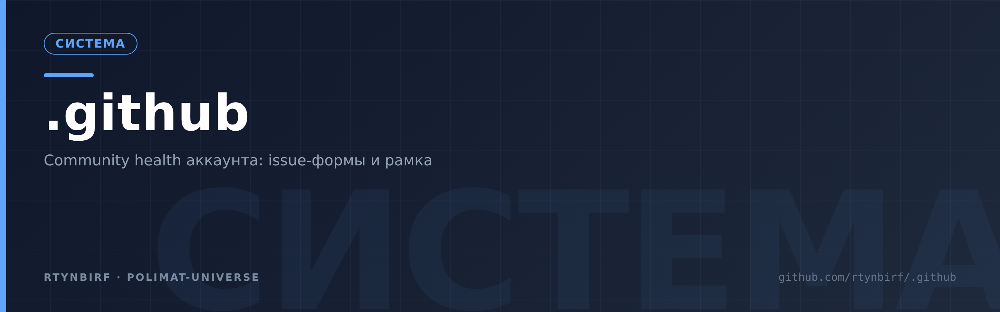

  

<!--ФОРЖ:МУЗА:НАЧАЛО-->

  
   
  

<!--ФОРЖ:МУЗА:КОНЕЦ-->

# .github — дефолтные community health files

Публичный репозиторий-носитель дефолтных файлов сообщества аккаунта `rtynbirf`.
Файлы отсюда наследуются всеми репозиториями аккаунта там, где у репо нет собственной версии
(механизм default community health files, docs.github.com). README и LICENSE не наследуются —
у каждого репо свои.

Состав: `ISSUE_TEMPLATE/` (bug + feature формы, config), `pull_request_template.md`,
`CODE_OF_CONDUCT.md`, `SUPPORT.md`, `ACCESSIBILITY.md`.

<!--ФОРЖ:ПОДВАЛ-->
---

  ◆ картина и штандарт — ручная ковка <a href="https://github.com/rtynbirf">КУЗНИ ПОЛИМАТ</a> · ЧЕЛОВЕК=АККАУНТ=PID1 ◆

