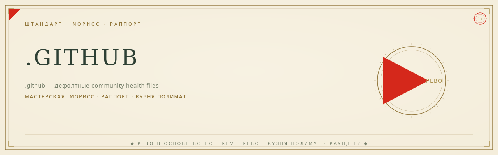
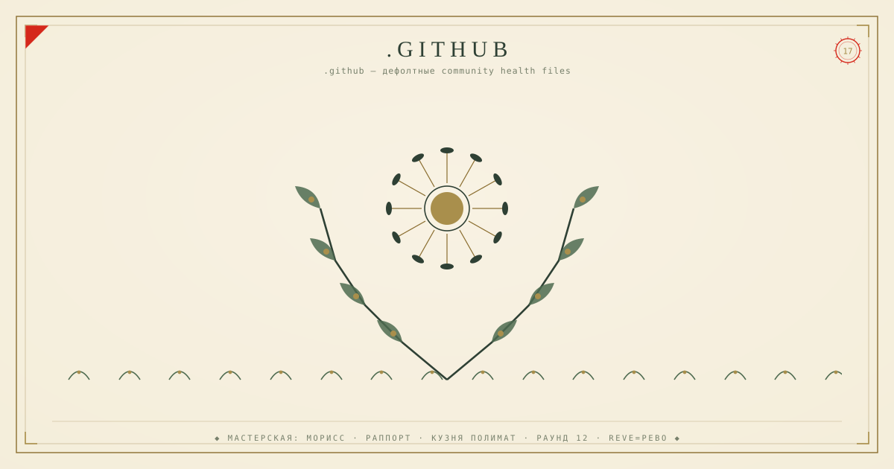
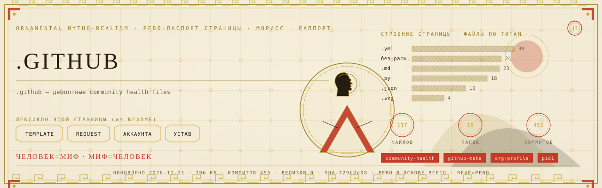

  

<!--ФОРЖ:МУЗА:НАЧАЛО-->

  
   
  

<!--ФОРЖ:МУЗА:КОНЕЦ-->

<!--ФОРЖ:ПАСПОРТ:НАЧАЛО-->

  

| ФАЙЛОВ | ПАПОК | КОММИТОВ | ОБНОВЛЕНО | РЕЛИЗОВ |
|---:|---:|---:|---|---:|
| 62 | 8 | 141 | 2026-11-16 | 1 |
<!--ФОРЖ:ПАСПОРТ:КОНЕЦ-->

# .github — дефолтные community health files

Публичный репозиторий-носитель дефолтных файлов сообщества аккаунта `rtynbirf`.
Файлы отсюда наследуются всеми репозиториями аккаунта там, где у репо нет собственной версии
(механизм default community health files, docs.github.com). README и LICENSE не наследуются —
у каждого репо свои.

Состав: `ISSUE_TEMPLATE/` (bug + feature формы, config), `pull_request_template.md`,
`CODE_OF_CONDUCT.md`, `SUPPORT.md`, `ACCESSIBILITY.md`.

## Карта репозитория

- `ISSUE_TEMPLATE/` — формы bug + feature и `config.yml`.
- `pull_request_template.md` — шаблон pull request.
- `CODE_OF_CONDUCT.md`, `SUPPORT.md`, `ACCESSIBILITY.md` — рамка сообщества.
- `CHRONICLE.md` — хроника дома.
- Файлы отсюда наследуют все 66 репо аккаунта, у которых нет собственной версии.

<!--ФОРЖ:ПОДВАЛ-->
---

  ◆ картина и штандарт — ручная ковка <a href="https://github.com/rtynbirf">КУЗНИ ПОЛИМАТ</a> · ЧЕЛОВЕК=АККАУНТ=PID1 ◆

